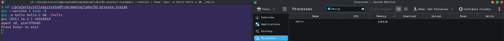
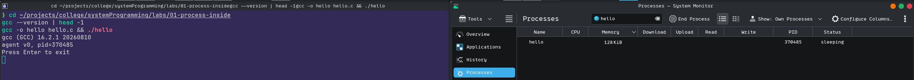
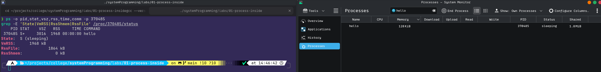
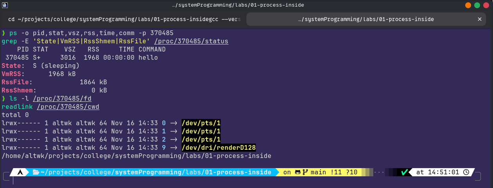
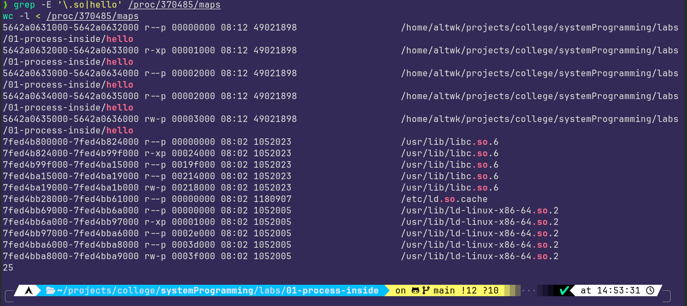
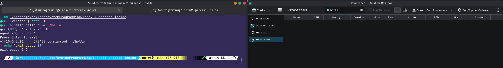
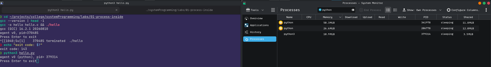
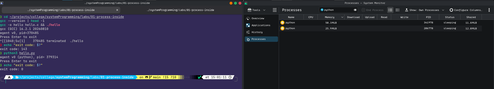

# ЛР 1. Процесс изнутри

Система: Arch Linux, ядро 6.18 x86_64 · компилятор: gcc (GCC) 16.2.1 20260810 (первая строка вывода версии)

## Программа на C
Программа напечатала PID 370485, монитор показал PID 370485.
Память процесса в мониторе: 128 КиБ (в оперативной памяти 1,9 МиБ, из них 1,8 МиБ общие — libc и загрузчик). Процессорное время: 0:00.00.
Пока программа ждёт Enter, процессорное время не растёт, потому что getchar делает системный вызов read, и ядро держит процесс в состоянии Sleeping, пока в терминале нет ввода.
Дескрипторов у процесса: 4 (0, 1, 2 и 9). Ввод и вывод (0, 1, 2) ведут в /dev/pts/1 — устройство окна терминала; дескриптор 9 → /dev/dri/renderD128 программа не открывала, он унаследован от терминала Ghostty, который рисует через видеокарту.
Системные библиотеки в процессе: libc.so.6 и загрузчик ld-linux-x86-64.so.2 (всего в /proc/370485/maps 25 строк).
После завершения из монитора терминал напечатал «370485 terminated ./hello» (так пишет zsh; bash пишет Terminated), код завершения 143 (128 + 15, сигнал SIGTERM).

## Программа на Python
Имя процесса в мониторе: python3, PID 379314, память 10,9 МиБ.
Памяти больше, чем у программы на C, примерно в 87 раз (10,9 МиБ против 128 КиБ; строк в карте памяти 132 против 25).
Общая библиотека у программ на C и Python: libc.so.6.
Код завершения при обычном выходе: 0.

## Помощник ИИ (Р1)
Запрос: «Объясни программу hello.c по строкам». Одно место, где ответ точнее или менее точен, чем глава 0.1: про getchar ИИ сказал только «ждёт нажатия клавиши», а в главе объяснено точнее — это системный вызов чтения, и процесс спит в ядре, не получая процессорного времени.

Не получилось: всё получилось
ИИ: использовал для сбора чисел из /proc и заполнения отчёта

## Снимки экрана

