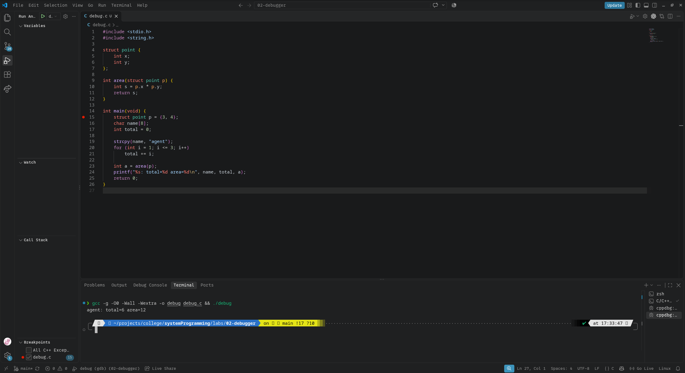
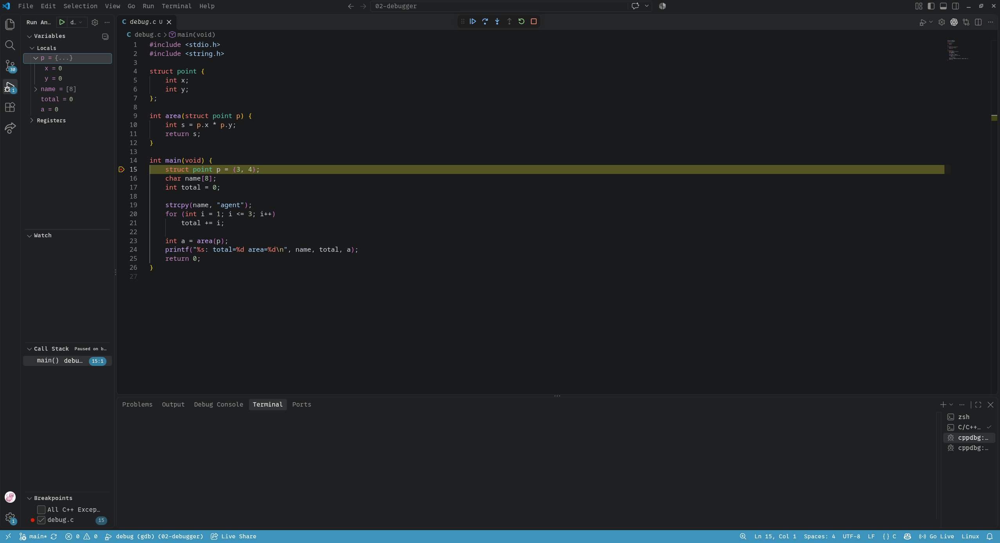
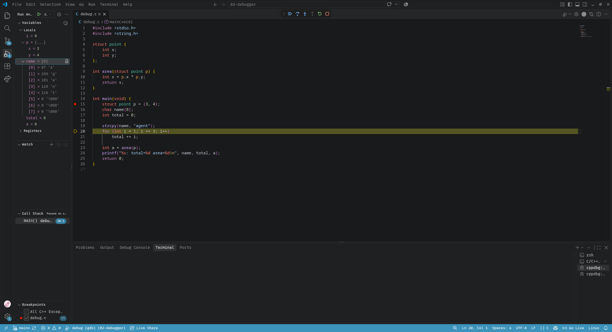
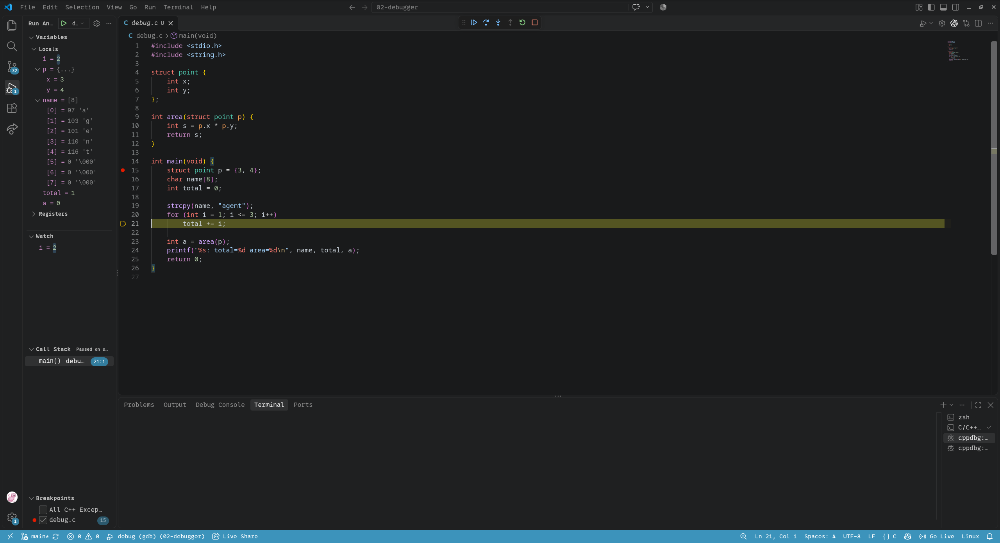
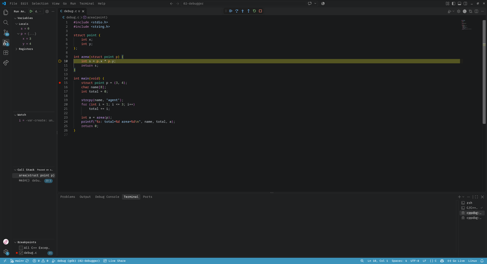
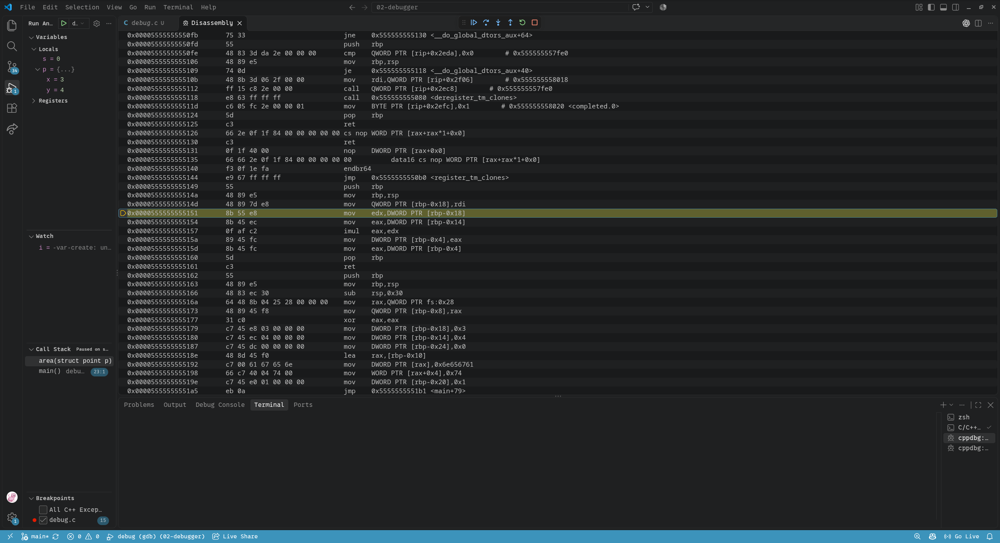
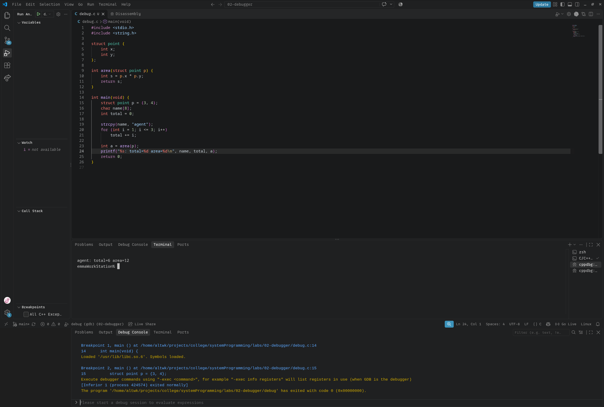

# ЛР 2. Программа в отладчике

Система: Arch Linux, ядро 6.18 x86_64 · отладчик: GDB 18.1 (LLDB, GDB или Visual Studio)

## Остановка и переменные
Программа без отладчика напечатала: agent: total=6 area=12
Точка останова на строке 15.
До строки 15: p.x = 0, p.y = 0, total = 0.
После строки 15: p.x = 3, p.y = 4.
Строку 16 отладчик пропустил, потому что `char name[8];` — только объявление без значения: для неё компилятор не создал ни одной машинной команды, место под массив выделено в кадре стека ещё при входе в main.
name[0] = 97 (код буквы), завершающий ноль в ячейке name[5].

## Цикл и функция
На кадре цикла: i = 2, total = 1; после следующего шага total = 3.
В стеке внутри area строк: 2, сверху функция area, под ней main на строке 23 (в моём debug.c перед вызовом area пустая строка, поэтому номера строк на 1 больше, чем в методичке).
Команда умножения в машинном коде: imul eax,edx (VS Code показывает синтаксис Intel; в AT&T-синтаксисе gdb это imul %edx,%eax).
Перед printf: a = 12, total = 6.
Код завершения программы: 0 (в Debug Console: «exited normally», «has exited with code 0»).

## Помощник ИИ (Р1)
Запрос: «Почему до выполнения строки 15 в p.x лежит случайное число?». Совпал ли ответ с шагом 4: да — локальная переменная лежит в стеке и до присваивания содержит то, что осталось в этой памяти; в моём запуске там оказались нули, но это случайность, а не гарантия.

Не получилось: всё получилось
ИИ: использовал для сбора значений из gdb и заполнения отчёта

## Снимки экрана

