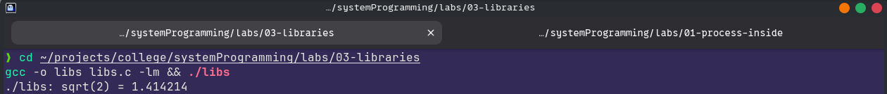
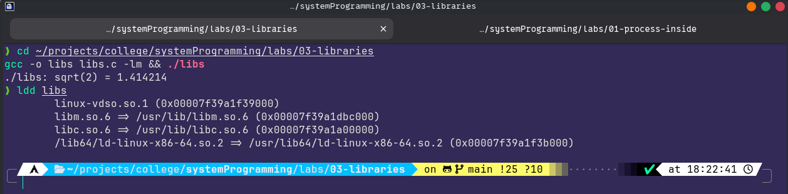
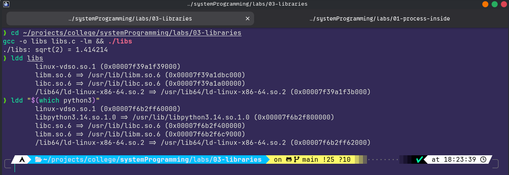
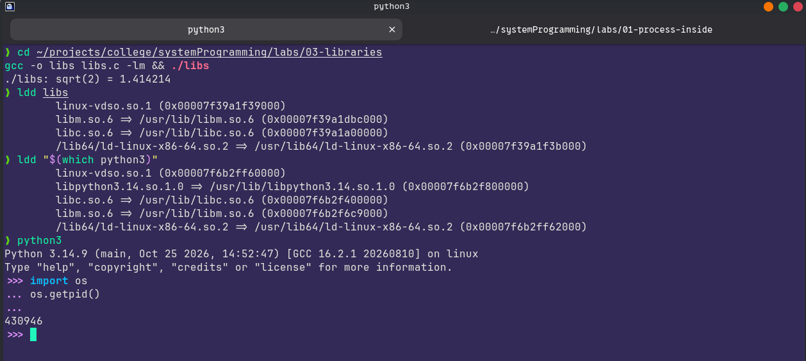
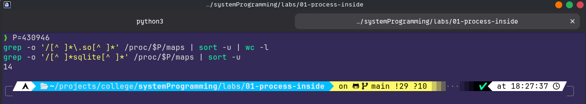
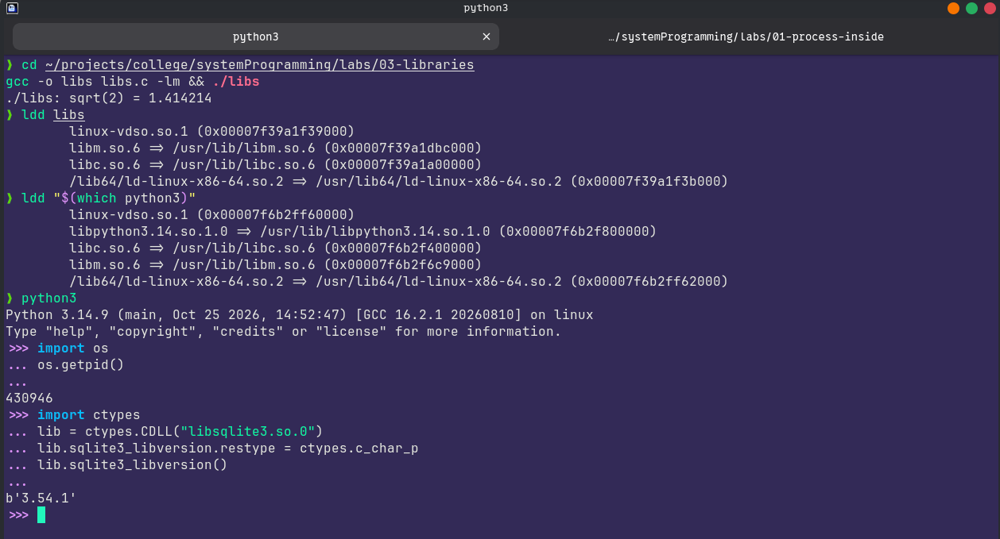
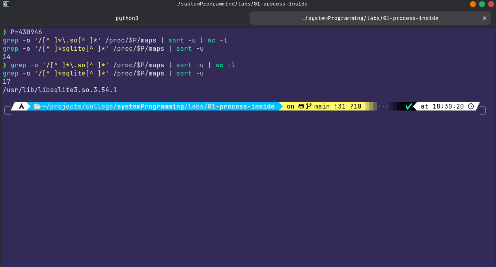

# ЛР 3. Библиотеки программы

Система: Arch Linux, ядро 6.18 x86_64

## Библиотеки файла
Программа напечатала: ./libs: sqrt(2) = 1.414214
Команда для списка библиотек файла: ldd libs
Библиотеки libs (4 строки ldd): linux-vdso.so.1, libm.so.6, libc.so.6, загрузчик ld-linux-x86-64.so.2
Почему в списке нет отдельной математической библиотеки (или почему она есть): есть — в Linux sqrt лежит в отдельной libm.so.6, а не в libc, поэтому её подключает ключ -lm; без него gcc пишет undefined reference to 'sqrt'.
Где лежит интерпретатор Python (файл или библиотека): в библиотеке /usr/lib/libpython3.14.so.1.0; файл /usr/bin/python3.14 — маленькая программа-запускатель, которая её подключает.

## Библиотеки процесса
PID Python: 430946 (Python 3.14.9)
Библиотек в процессе до ctypes.CDLL: 14, после: 17 (добавились libsqlite3, модуль _ctypes и libffi)
Загруженная библиотека и её полный путь: /usr/lib/libsqlite3.so.3.54.1 (короткое имя libsqlite3.so.0 — ссылка на этот файл)
Функция вернула: b'3.54.1'

## Помощник ИИ (Р1)
Запрос: «Чем статическая компоновка отличается от динамической?». Совпал ли ответ с таблицей §2: да — при статической код библиотеки копируется в исполняемый файл при сборке, при динамической в файле только ссылка, а библиотеку подключает загрузчик при запуске и её делят все процессы.

Не получилось: всё получилось
ИИ: использовал для сбора данных из ldd и /proc и заполнения отчёта

## Снимки экрана

