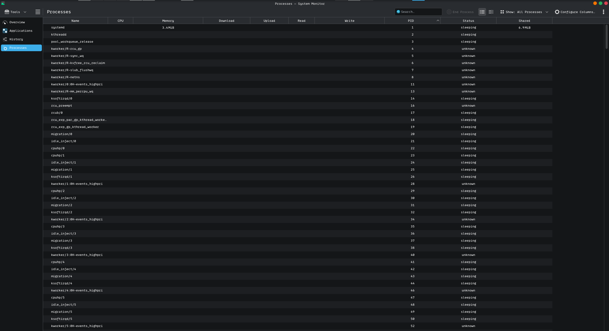
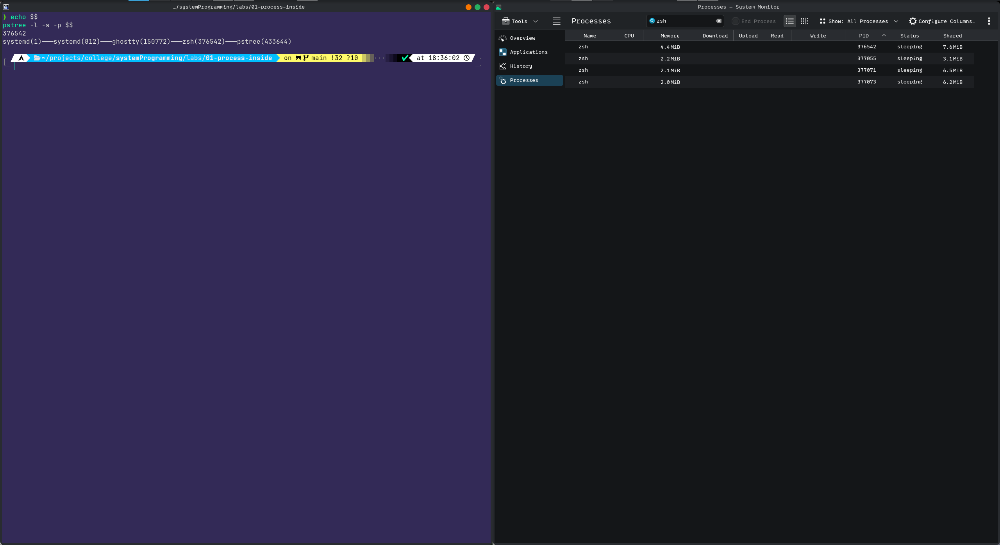
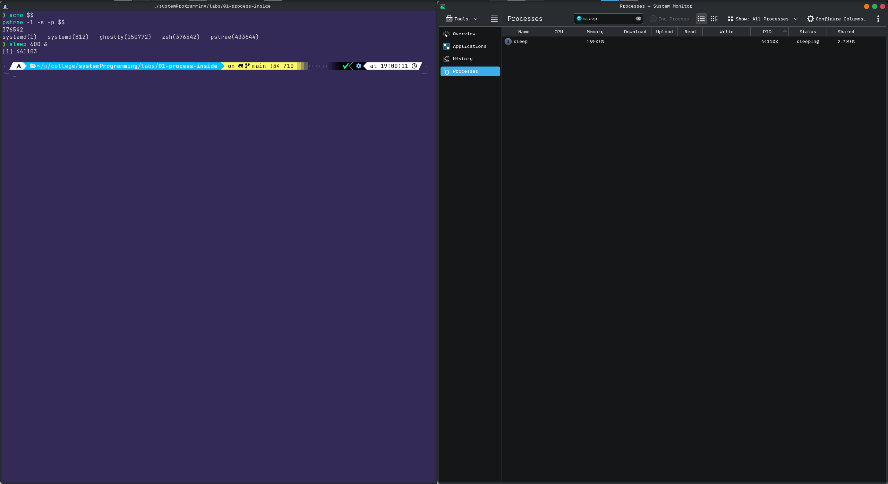
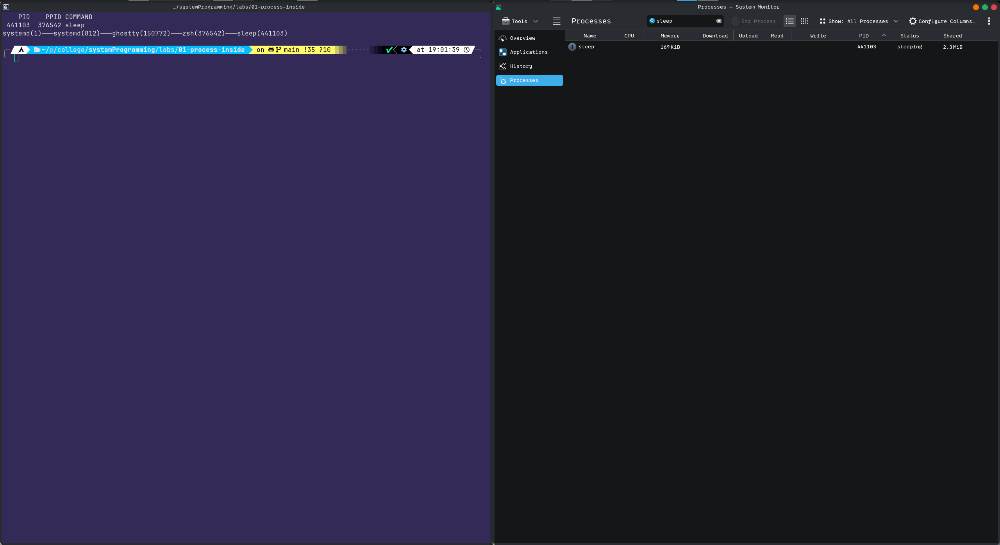
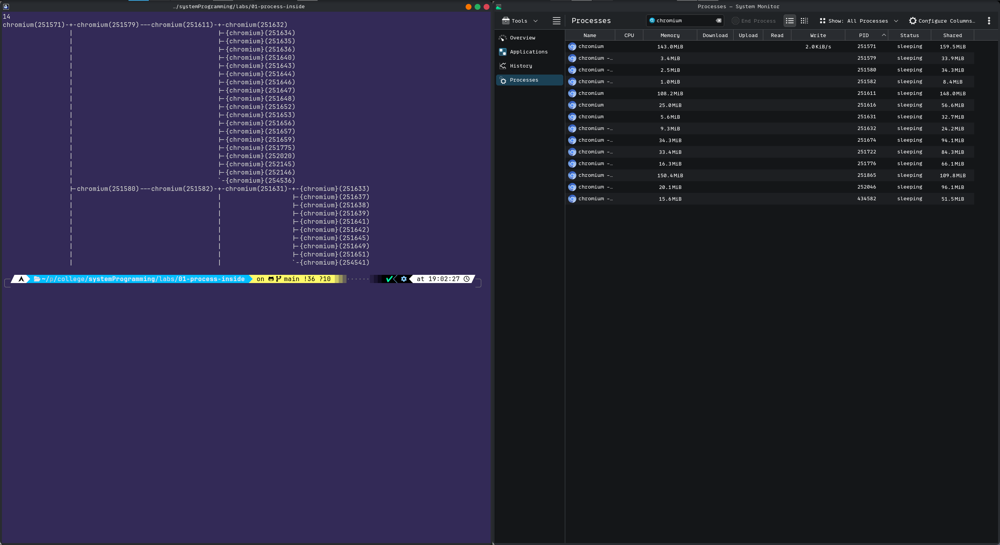
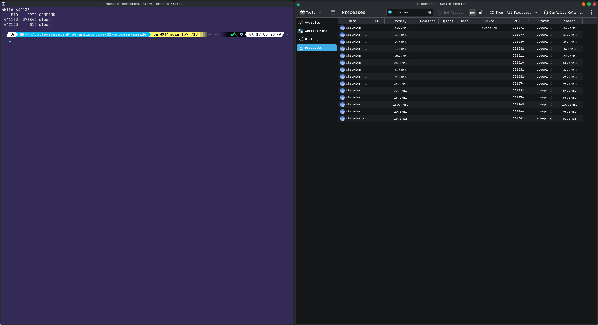
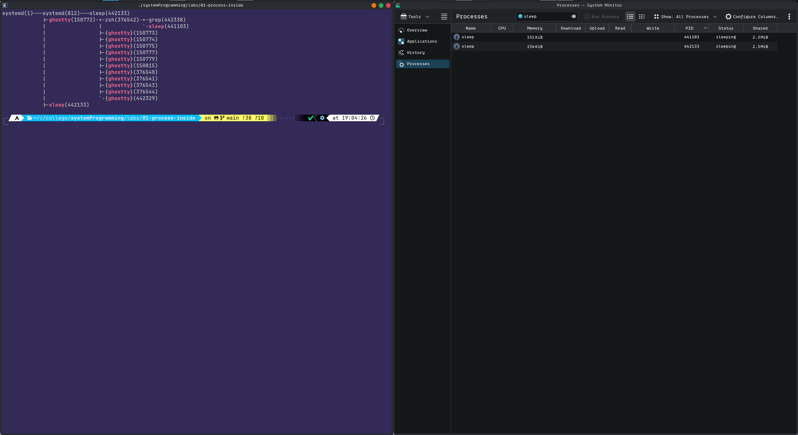

# ЛР 4. Дерево процессов

Система: Arch Linux, KDE Plasma (ядро 6.18 x86_64) · монитор: Системный монитор KDE (plasma-systemmonitor; в нём список без дерева, поэтому ветки показаны через pstree), ps, pstree

## Дерево
Процесс в начале дерева и его номер: systemd, номер 1 (рядом kthreadd, номер 2, — родитель потоков ядра)
Цепочка родителей терминала (имя и номер): zsh (376542) → ghostty (150772) → systemd (812, менеджер сеанса пользователя altwk) → systemd (1)
Дочерний процесс: номер 441103, родитель 376542 (zsh)
Команда, которой проверен родитель: `ps -o pid,ppid,comm -p 441103` → PPID 376542; `pstree -l -s -p 441103` → systemd(1)───systemd(812)───ghostty(150772)───zsh(376542)───sleep(441103); родитель совпал с деревом
Процессов у браузера и имя процесса вкладок: у Chromium 14 процессов chromium (`pgrep -c chromium`): главный chromium(251571), под ним две ветки zygote — 251579 и 251580, от которых идут дочерние процессы; вкладки работают в процессах chromium с ключом --type=renderer

## Сирота
Номер сироты: 442133
Номер родителя до и после завершения настоящего родителя: до — оболочка `bash -c`, которая запустила sleep и сразу завершилась; после — 812 (systemd сеанса)
Где сирота стоит в дереве: прямо под systemd (812) — менеджер сеанса объявил себя приёмным родителем (subreaper), поэтому сирота досталась ему, а не systemd с номером 1

Не получилось: всё получилось

## Снимки экрана

Сохраните снимок поверх заглушки в папке `screenshots/` с тем же именем — ссылки ниже менять не нужно.

### 1. Начало дерева процессов
Шаг 1. Видно: дерево процессов в мониторе: первые процессы системы и их номера.

### 2. Терминал и его родители
Шаг 2. Видно: ветка дерева от процесса терминала вверх до процесса системы.

### 3. Дочерний процесс терминала
Шаг 3. Видно: запущенный из терминала процесс под оболочкой терминала.

### 4. Родитель по команде
Шаг 4. Видно: вывод команды с номером процесса и номером его родителя.

### 5. Процессы браузера
Шаг 5. Видно: раскрытая ветка браузера с дочерними процессами.

### 6. Процесс без родителя
Шаг 6. Видно: команда запуска и номер родителя у оставшегося процесса.

### 7. Сирота в дереве
Шаг 7. Видно: тот же процесс в дереве монитора на новом месте.

