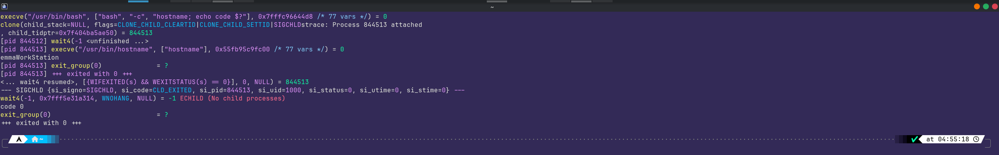
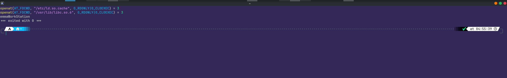
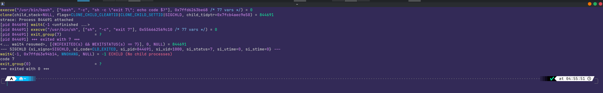
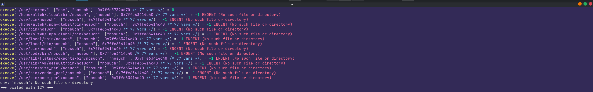
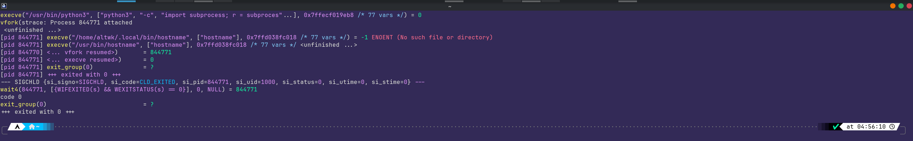

# ЛР 5. Рождение процесса

Система: Arch Linux, ядро 6.18 x86_64
Программа записи: strace 7.3

## Рождение
Родитель (имя и номер): bash, номер 844512 (оболочка `bash -c`)
Номер нового процесса: 844513
Событие или вызов, которым создан процесс: `clone` (флаги CLONE_CHILD_CLEARTID|CLONE_CHILD_SETTID|SIGCHLD — копия процесса, как fork), затем в ребёнке `execve("/usr/bin/hostname") = 0`; родитель ждёт в `wait4`
Библиотек загружено и первая из них: 1 — /usr/lib/libc.so.6; первым открыт /etc/ld.so.cache, но это кэш загрузчика со списком библиотек, а не библиотека

## Завершение
Код завершения у ребёнка и у родителя: у ребёнка (sh, номер 844691) `exit_group(7)`; у родителя (bash, номер 844690) `wait4` вернул WEXITSTATUS(s) == 7, и `$?` = 7 — напечатано «code 7»
Программа nosuch: папок проверено 14 (столько записей в PATH; /usr/bin в нём трижды, ~/.npm-global/bin дважды — env проверяет и повторы), ошибка ENOENT (2, No such file or directory), код 127

## Запуск из Python
Номер Python и номер ребёнка: Python 844770, ребёнок 844771
Чем запуск из Python отличается от запуска из оболочки: Python 3.14 создаёт ребёнка вызовом `vfork` (то же, что clone с CLONE_VM|CLONE_VFORK): память не копируется, Python стоит, пока ребёнок не выполнит execve. Ребёнок сам ищет hostname по PATH: сначала ~/.local/bin — ENOENT, потом /usr/bin/hostname = 0. Оболочка делает `clone` без CLONE_VM — полную копию процесса. Ещё Python ждёт конкретного ребёнка `wait4(844771)`, а bash — любого `wait4(-1)`

Не получилось: всё получилось; на Arch не было hostname — поставил пакет inetutils

## Снимки экрана

Сохраните снимок поверх заглушки в папке `screenshots/` с тем же именем — ссылки ниже менять не нужно.

### 1. Рождение процесса
Шаг 1. Видно: запись запуска `hostname`: родитель создаёт процесс, у нового процесса номер родителя.

### 2. Библиотеки нового процесса
Шаг 2. Видно: библиотеки, которые загрузил `hostname`, и первая из них.

### 3. Код завершения 7
Шаг 3. Видно: завершение ребёнка с кодом 7 и тот же код у родителя.

### 4. Программы нет
Шаг 4. Видно: поиск `nosuch` по папкам из PATH и ошибка «не найдено».

### 5. Запуск из Python
Шаг 5. Видно: Python создаёт процесс `hostname`: номер Python и номер ребёнка.

