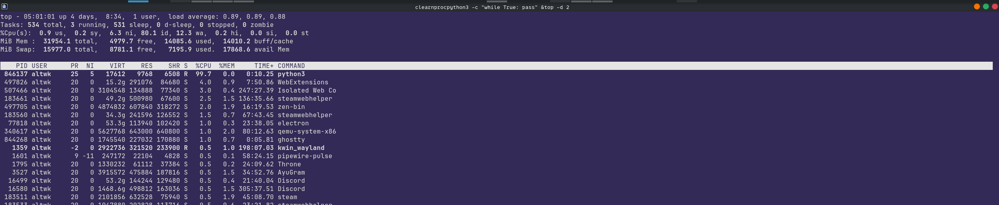
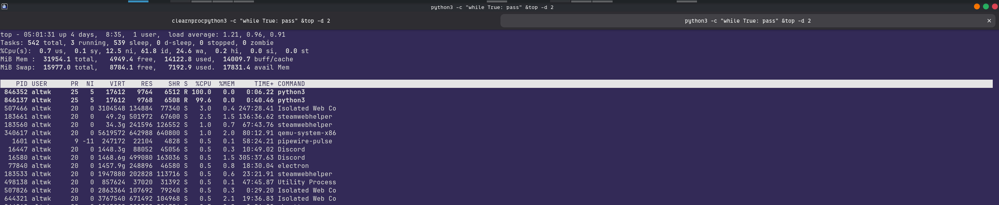
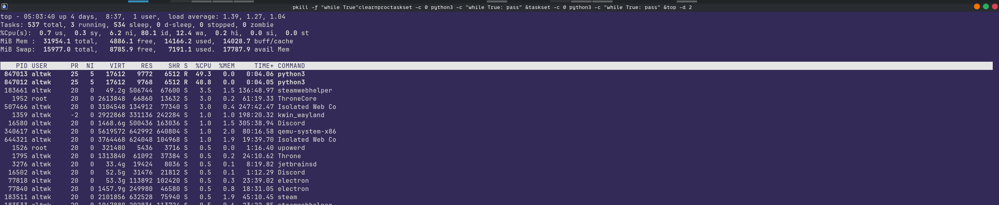
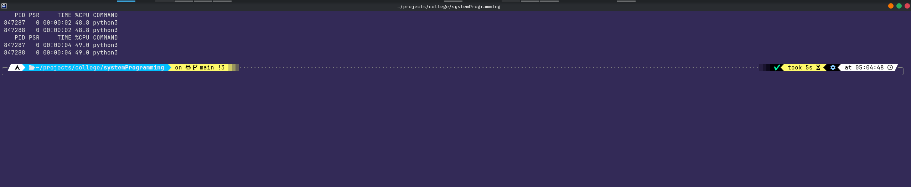

# ЛР 6. Кто загружает процессор

Система: Arch Linux, KDE Plasma (ядро 6.18 x86_64) · монитор: top
Ядер (логических процессоров): 16 (`nproc`)

## Одна нагрузка
Процент процесса в мониторе: python3 (846137) — 99,7% в столбце %CPU, то есть одно целое ядро
Общая загрузка: строка %Cpu(s) — 80,1% простоя (id); занятость python3 видна в ni = 6,3%, а не в us, потому что процесс запущен с приоритетом nice 5 (столбец NI = 5). Одно ядро из 16 — это 100 / 16 = 6,25% всей системы, ровно столько и показывает ni
На каких ядрах видна нагрузка: ядро не постоянное — планировщик пересаживает процесс; на замере ps два свободных процесса стояли на ядрах 5 и 12 (столбец PSR)

## Две нагрузки
Проценты обеих нагрузок и общая загрузка: python3 846352 — 100,0%, 846137 — 99,6%; в сводке ni выросло с 6,3% до 12,5% — ровно вдвое: два ядра из 16, простой упал до 61,8%
На одном ядре (в macOS — фоновый режим): с `taskset -c 0` обе программы получили только ядро 0 и делят его пополам — 847012 и 847013 по 48,8% и 49,3%, хотя остальные ядра свободны

## Процессорное время
Первый замер, второй замер, пауза: у 847287 и 847288 — 00:00:02, через 5 секунд — 00:00:04; оба всё время на ядре 0 (PSR = 0)
Загрузка по замерам: прирост 2 с за 5 с = 40% на каждую; ps показывает целые секунды, поэтому оценка грубая — монитор в это же время показывал по 49%, то есть по половине ядра
Почему процент в мониторе не говорит о скорости работы: процент — это доля времени, которую процесс сидит на ядре, а не сколько полезного он сделал. Пустой цикл тратит 100% ядра и не делает ничего полезного, а две программы на одном ядре показывают по 50% и работают вдвое медленнее, хотя остальные ядра простаивают

Не получилось: сначала запускал команды в разных вкладках, и `kill %1 %2` не остановил программы из других вкладок — завершил всё через `pkill -f "while True"` и повторил шаги 4–5

## Снимки экрана

Сохраните снимок поверх заглушки в папке `screenshots/` с тем же именем — ссылки ниже менять не нужно.

### 1. Одна нагрузка
Шаг 1. Видно: процесс Python в мониторе: его процент и общая загрузка.

### 2. Две нагрузки
Шаг 3. Видно: два процесса Python и загрузка ядер.

### 3. Нагрузки на одном ядре
Шаг 4. Видно: две нагрузки на одном ядре и их проценты; в macOS — два числа оборотов цикла.

### 4. Процессорное время
Шаг 5. Видно: два замера процессорного времени с паузой между ними.

