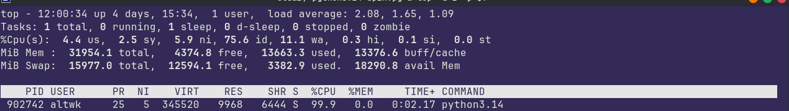
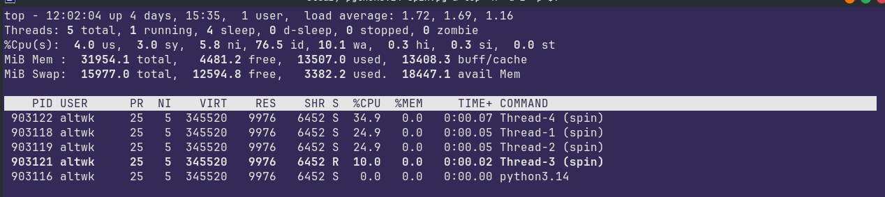
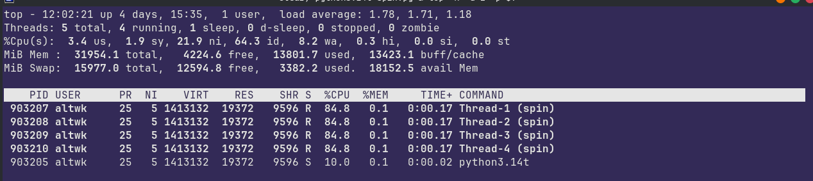
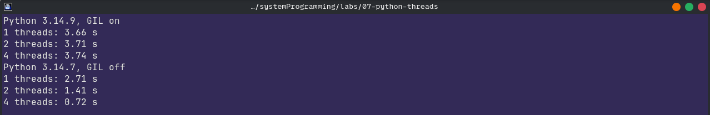

# ЛР 7. Потоки Python и GIL

Система: Arch Linux, KDE Plasma (ядро 6.18 x86_64) · монитор: top (с ключом -H — по строке на поток)
Ядер (логических процессоров): 16 (`nproc`)
Версии Python (обычный и без GIL): Python 3.14.9 (системный, python3.14) и Python 3.14.7 без GIL (python3.14t, поставлен через uv)

## Python с GIL
Процент процесса и число потоков: python3.14 — 99,9% (одно ядро); потоков 5 — четыре Thread-N (spin) и главный
Сколько потоков выполняется одновременно: один — в сводке `Threads: 5 total, 1 running, 4 sleep`; четыре spin делят одно ядро: 34,9 + 24,9 + 24,9 + 10,0 ≈ 95%, статус R только у одного

## Python без GIL
Процент процесса и проценты потоков: `4 running` — все четыре spin по 84,8%, вместе ≈ 340%, то есть четыре ядра одновременно (главный поток python3.14t ждёт)

## Время работы
С GIL, 1 / 2 / 4 потока: 3,66 / 3,71 / 3,74 с — лишние потоки не ускоряют, а чуть замедляют (передача замка)
Без GIL, 1 / 2 / 4 потока: 2,71 / 1,41 / 0,72 с — 4 потока быстрее одного в 3,8 раза; ядер 16, поэтому четырём потокам ядер хватает
Без GIL с PYTHON_GIL=1: 2,78 / 2,77 / 2,78 с (в выводе снова `GIL on`) — ускорение пропало, значит его давало именно отсутствие замка
Ожидание, 1 и 4 потока: 2,00 и 2,00 с — четыре сна по 2 с прошли одновременно, а не за 8 с
Почему ожидающие потоки ускоряются и с GIL: поток, который ждёт (sleep, сеть, диск), отпускает замок на время ожидания, и остальные потоки идут дальше; замок мешает только потокам, которые одновременно выполняют код Python

Не получилось: всё получилось; Shift+H в top не успевал нажать за 15 секунд — запускал top сразу в режиме потоков (`top -H`). Один поток без GIL (2,71 с) быстрее, чем с GIL (3,66 с), — это разные сборки (uv 3.14.7 и системная 3.14.9), а не эффект замка: с PYTHON_GIL=1 та же сборка тоже даёт 2,78 с

## Снимки экрана

Сохраните снимок поверх заглушки в папке `screenshots/` с тем же именем — ссылки ниже менять не нужно.

### 1. Четыре потока с GIL
Шаг 1. Видно: процесс Python в мониторе: его процент и число потоков.

### 2. Потоки процесса
Шаг 2. Видно: список потоков процесса: сколько выполняется, сколько ждёт.

### 3. Четыре потока без GIL
Шаг 3. Видно: процесс python3.14t в мониторе: его процент.

### 4. Время работы
Шаг 4. Видно: вывод threads.py в Python с GIL и без.

