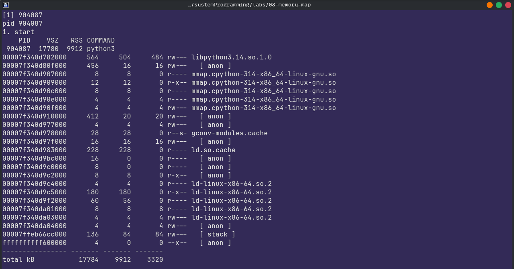
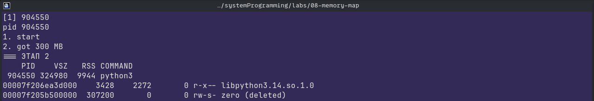
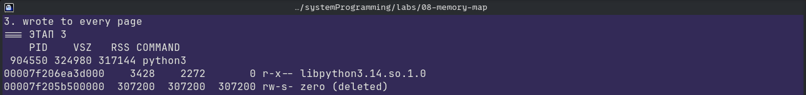
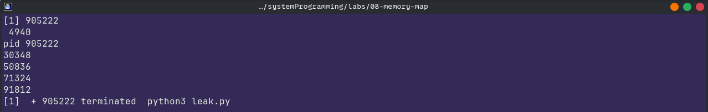

# ЛР 8. Карта памяти

Система: Arch Linux, KDE Plasma (ядро 6.18 x86_64), Python 3.14.9
Чем мерил (виртуальная и занятая): `ps -o pid,vsz,rss,comm` — VSZ (обещанная, виртуальная) и RSS (занятая в оперативной памяти), в КБ; карта — `pmap -x`

## Этапы mem.py
Старт: VSZ 17 780 КБ, RSS 9 912–9 944 КБ
Получил 300 МБ: VSZ 324 980 КБ (+307 200 КБ = 300 МБ), RSS 9 944 КБ — не изменилось; в pmap новый кусок `zero (deleted)` на 307 200 КБ с RSS 0
Записал в каждую страницу: VSZ 324 980 КБ — то же, RSS 317 144 КБ (+300 МБ); у куска `zero (deleted)` RSS стал 307 200 КБ
Освободил: VSZ 17 780 КБ, RSS 9 944 КБ — вернулось к началу
Почему занятая память выросла только на третьем этапе: mmap только резервирует адреса (обещание), а настоящую страницу ядро выделяет при первой записи в неё — по ошибке страницы (page fault). Пока в 300 МБ ничего не записано, им не соответствует ни одной страницы в оперативной памяти

## Карта памяти
Из каких частей состоит память процесса: код и данные интерпретатора (libpython3.14.so.1.0), загрузчик ld-linux-x86-64.so.2, модули Python (mmap.cpython-314-x86_64-linux-gnu.so), файлы-кэши (ld.so.cache, gconv-modules.cache, locale-archive), анонимная память [ anon ] — куча и данные, и [ stack ]; итог pmap — total 17 784 КБ, RSS 9 912 КБ, совпадает с ps

## Утечка
Пять замеров leak.py: 4 940 → 30 348 → 50 836 → 71 324 → 91 812 КБ
На сколько росла память за 2 секунды: на 20 488 КБ ≈ 20 МБ — две порции по 10 МБ; число только растёт и не останавливается, так выглядит утечка

Не получилось: вручную не успевал попасть в этапы mem.py — снимал этапы 2–4 одной командой со `sleep` между замерами

## Снимки экрана

Сохраните снимок поверх заглушки в папке `screenshots/` с тем же именем — ссылки ниже менять не нужно.

### 1. Карта памяти
Шаг 2. Видно: карта памяти процесса mem.py на старте и её итог.

### 2. Получено 300 МБ
Шаг 3. Видно: виртуальная память выросла на 300 МБ, занятая — нет.

### 3. Страницы заняты
Шаг 4. Видно: занятая память (в macOS — физический след) после записи в каждую страницу.

### 4. Утечка
Шаг 6. Видно: пять замеров памяти leak.py.

