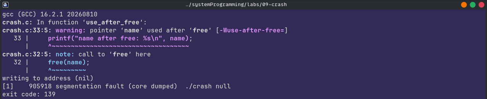
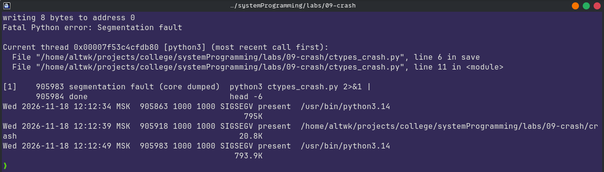
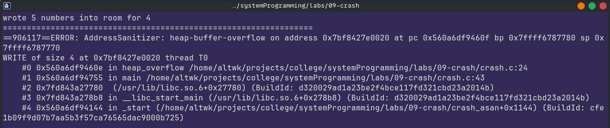
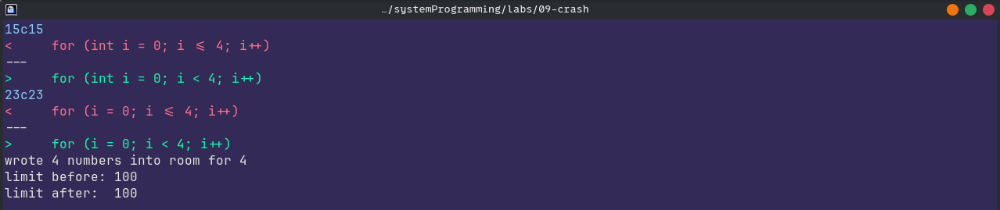

# ЛР 9. Разбор падения

Система: Arch Linux, KDE Plasma (ядро 6.18 x86_64), Python 3.14.9
Компилятор: gcc (GCC) 16.2.1 20260810

## Падение
crash null: что напечатано и код завершения: `writing to address (nil)`, затем оболочка — `segmentation fault (core dumped) ./crash null`; строка `not reached` не напечатана; код 139 = 128 + 11, сигнал 11 — SIGSEGV, обращение к чужой памяти
ctypes_crash.py: что напечатал Python: `writing 8 bytes to address 0`, затем `Fatal Python error: Segmentation fault` и стек от faulthandler — ctypes_crash.py, строка 6 в save и строка 11 в <module>; ошибка в коде на C убила весь процесс python3
Где система записала падение: в systemd-coredump — `coredumpctl list` показывает записи SIGSEGV с дампом (present): /usr/bin/python3.14 (PID 905983) и labs/09-crash/crash (PID 905918)

## Молчаливые ошибки
crash overflow: limit до и после, код: limit before 100, limit after 7, код 0 — пятое число легло на соседнюю переменную limit, а программа закончилась «успешно»
crash heap без проверки: `wrote 5 numbers into room for 4`, код 0 — запись за край выделенной памяти прошла молча
AddressSanitizer для heap: вид ошибки и строка: `ERROR: AddressSanitizer: heap-buffer-overflow`, `WRITE of size 4` в heap_overflow, crash.c:24 (data[i] = 7 при i = 4), вызвано из main, crash.c:43
AddressSanitizer для uaf: вид ошибки и две строки: `ERROR: AddressSanitizer: heap-use-after-free` — чтение в use_after_free, crash.c:33 (`printf(... name)`), а в блоке «freed by thread T0 here» — память отдана в crash.c:32 (`free(name)`); обе вызваны из main, crash.c:45; об этом же gcc предупредил ещё при сборке: `crash.c:33:5: warning: pointer 'name' used after 'free'`, `crash.c:32:5: note: call to 'free' here`

## Исправление
Что изменено и что напечатала исправленная программа: в crash_fixed.c оба цикла `i <= 4` заменены на `i < 4` (diff: строки 15 и 23); собранная с AddressSanitizer копия напечатала `wrote 4 numbers into room for 4` и `limit before: 100`, `limit after: 100` — проверка молчит, лишних записей нет

Не получилось: всё получилось

## Снимки экрана

Сохраните снимок поверх заглушки в папке `screenshots/` с тем же именем — ссылки ниже менять не нужно.

### 1. Падение
Шаг 1. Видно: запуск crash null и код завершения.

### 2. Падение Python
Шаг 2. Видно: вывод ctypes_crash.py и запись системы о падении.

### 3. Отчёт AddressSanitizer
Шаг 4. Видно: вывод crash heap без проверки и с AddressSanitizer (на Windows с ARM — без проверки).

### 4. Исправление
Шаг 6. Видно: разница файлов и вывод исправленной программы.

